# RetailPulse Frontend Architecture

Maintained in this independent Git repository at **docs/architecture.md**. Updated **2026-11-09**. The guide covers the implemented stack, interfaces, data model, operational limits, and release requirements.

## Contents

1. [Scope, users, and repository boundary](#1-scope-users-and-repository-boundary)
2. [Context, containers, and trust boundaries](#2-context-containers-and-trust-boundaries)
3. [Source ownership and module map](#3-source-ownership-and-module-map)
4. [Screens, navigation, and lifecycle](#4-screens-navigation-and-lifecycle)
5. [Primary workflows and recovery](#5-primary-workflows-and-recovery)
6. [Domain, persistence, and data ownership](#6-domain-persistence-and-data-ownership)
7. [API and internal contracts](#7-api-and-internal-contracts)
8. [Security, privacy, and egress](#8-security-privacy-and-egress)
9. [Design, accessibility, and platform adapters](#9-design-accessibility-and-platform-adapters)
10. [Build, checks, and deployment](#10-build-checks-and-deployment)
11. [Architecture decisions and tradeoffs](#11-architecture-decisions-and-tradeoffs)
12. [Requirements traceability](#12-requirements-traceability)
13. [Dated verification and limitations](#13-dated-verification-and-limitations)
14. [Extension rules and companion repository](#14-extension-rules-and-companion-repository)

## 1. Scope, users, and repository boundary

Synthetic sales analytics, report filtering, and alerts for retail managers.

Sales/product reports, filters, alerts, synthetic ingestion, and spreadsheet-safe CSV export.

This repository owns the React/Vite web interface, public content, interaction state, and API adapter. The API owns authoritative domain records and permission decisions.

There are two independent Git roots for this application, each with its own README and architecture guide. A parent app/workspace folder is a checkout convenience. Use synthetic records; current local services remain on loopback.

The current implementation boundary is defined by the source map and contracts in this guide.

## 2. Context, containers, and trust boundaries

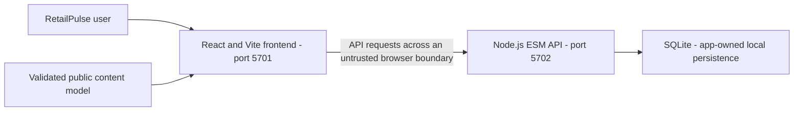

The browser must not grant roles or confirm prices, balances, payments, stock, or workflow completion based only on local state.

### Component boundaries

1. `retailpulse-frontend/src/main.tsx` mounts the React application.
2. `retailpulse-frontend/src/App.tsx` loads the public model, checks API health, owns filters and navigation, and requests report data.
3. `retailpulse-frontend/src/components/` renders overview, revenue, store, product, alert, and settings views.
4. `retailpulse-frontend/src/lib/api.ts` builds requests, validates API response shapes, and propagates abort signals.
5. `retailpulse-backend/src/api-server.mjs` routes requests through the origin allowlist and validated reporting API.
6. `retailpulse-backend/src/http-utils.mjs` owns request IDs, safe response envelopes, bounded JSON parsing, and CSV escaping.
7. `retailpulse-backend/src/analytics.repository.mjs` coordinates transactional writes and report queries.
8. `retailpulse-backend/src/analytics.query.mjs`, `analytics.metrics.mjs`, and `analytics.seed.mjs` separate parameterized reads, pure calculations, and synthetic seed generation.
9. React updates the active view while retaining the selected reporting filters.

## 3. Source ownership and module map

| Owner/path                                                                                                                                                                                                                  | Responsibility                                                     |
| --------------------------------------------------------------------------------------------------------------------------------------------------------------------------------------------------------------------------- | ------------------------------------------------------------------ |
| [src/main.tsx](../src/main.tsx)                                                                                                                                                                                             | Web entry and composition                                          |
| [src/lib/api.ts](../src/lib/api.ts)                                                                                                                                                                                         | API transport and response boundary                                |
| [src/config.ts](../src/config.ts)                                                                                                                                                                                           | Build-time API mode selection                                      |
| [src/lib/api-schemas.ts](../src/lib/api-schemas.ts)                                                                                                                                                                         | Runtime boundary validation                                        |
| [src/App.tsx](../src/App.tsx)                                                                                                                                                                                               | Screens, composition, and interaction owners; see screen inventory |
| [src/hooks/use-app-settings.ts](../src/hooks/use-app-settings.ts) [src/hooks/use-debounced-value.ts](../src/hooks/use-debounced-value.ts) [src/hooks/use-workspace-actions.ts](../src/hooks/use-workspace-actions.ts) | Client hooks, presentation state, and domain adapters              |
| [src/App.css](../src/App.css) [src/index.css](../src/index.css)                                                                                                                                                          | Authored styling and adaptation rules                              |
| [public/retailpulse-model.json](../public/retailpulse-model.json)                                                                                                                                                           | Active public content/locale contract; no private credentials      |
| [e2e](../e2e)                                                                                                                                                                                                               | Existing test/support directory; configured does not mean rerun    |
| [src/test](../src/test)                                                                                                                                                                                                     | Existing test/support directory; configured does not mean rerun    |
| [.github/workflows](../.github/workflows)                                                                                                                                                                                   | Configured CI; hosted outcomes require separate verification       |
| [src/App.test.tsx](../src/App.test.tsx) [src/components/analytics-charts.test.tsx](../src/components/analytics-charts.test.tsx)                                                                                          | Examples of existing colocated tests                               |

The source map follows the existing framework directories and test placement.

## 4. Screens, navigation, and lifecycle

UI entry and interaction owners:

- [src/App.tsx](../src/App.tsx)
- [src/components/AlertsView.tsx](../src/components/AlertsView.tsx)
- [src/components/OverviewView.tsx](../src/components/OverviewView.tsx)
- [src/components/ProductsView.tsx](../src/components/ProductsView.tsx)
- [src/components/SettingsView.tsx](../src/components/SettingsView.tsx)
- [src/components/StoresView.tsx](../src/components/StoresView.tsx)
- [src/components/WorkspaceShell.tsx](../src/components/WorkspaceShell.tsx)

The active model is [public/retailpulse-model.json](../public/retailpulse-model.json). Preserve existing loading, empty, validation, permission, success, and failure states; model text does not provide server identity. This is a web SPA; the current source owns view/tab selection and component lifecycle. The Vercel rewrite is hosting configuration, not an additional UI router. Follow the authored source for request cancellation, retry, focus cleanup, and local preference behavior; do not infer an offline queue where none exists.

## 5. Primary workflows and recovery

### Primary workflows

1. Open workspace: fetch and validate the public model, check API health, request dashboard data, and show retryable loading/error states.
2. Filter performance: validate reporting period, store, and category on the server; return aggregates or a safe error with request ID.
3. Review revenue: compare the selected reporting period with the prior period and inspect daily trends.
4. Inspect a store: compare locations, open a detail view, and review its trend and category mix.
5. Find a product: search and sort products, then inspect an individual product.
6. Update an alert: validate threshold and enabled state, persist the rule and activity event transactionally, and refresh its status.
7. Add sales records: send an idempotency key, insert configured patterns once in a transaction, and refresh reports; replay does not duplicate rows.
8. Export a report: validate filters, escape CSV cells, and download the scoped report.
9. Change appearance: apply light or dark tokens and save the preference in browser storage.
10. Recover from API/network failure: preserve prior data when available, show a safe error, and retry. A browser-offline event adds a model-backed stale-data notice; an online event refreshes the API snapshot. This is not an offline write queue.

### Use-case authorization, state, and recovery

All current actors are unauthenticated local browser users; the displayed
"Retail analyst" identity is presentation copy, not a credential. Consequently
there is no role-specific permission matrix or store/tenant ownership boundary.

| Use case              | Preconditions and state changes                                                                                                                                                          | Authorization                                                            | Failures and recovery                                                                                                                                 |
| --------------------- | ---------------------------------------------------------------------------------------------------------------------------------------------------------------------------------------- | ------------------------------------------------------------------------ | ----------------------------------------------------------------------------------------------------------------------------------------------------- |
| Open workspace        | Load and validate the model, read local theme preference, request health and initial report. No business write.                                                                          | No sign-in. API origin allowlist only.                                   | Invalid model shows a visible bootstrap error code. API failures show safe model copy and retry; the prior snapshot is retained when one exists.      |
| Filter reports        | Select a supported range/store/category; API validates identifiers and recalculates aggregates. No write.                                                                                | No role or ownership checks.                                             | Invalid range/category returns a stable 400 code; unknown store returns 404. UI displays mapped copy and keeps filter controls available.             |
| Review revenue        | Read dashboard summary, current/previous comparisons, and daily series. No write.                                                                                                        | No sign-in.                                                              | Safe API error; refresh retries current filters.                                                                                                      |
| Inspect store/product | Select an API-backed result and read its detail endpoint. No write.                                                                                                                      | No resource ownership check; public only within local synthetic service. | Unknown identifiers return 404; safe model copy and back-to-list action.                                                                              |
| Change alert          | Validate a numeric threshold in the UI and again against API bounds; transactionally update the rule and activity event.                                                                 | No authenticated role; any local API caller can edit seeded rules.       | Malformed/out-of-range input returns 400; unknown alert returns 404; safe UI error and retry after correcting input.                                  |
| Add sales records     | Generate an idempotency key and transactionally insert configured synthetic sales patterns, batch record, and activity event. Replay returns the existing result without duplicate rows. | No authenticated role; endpoint is not a real POS integration.           | Missing/invalid key returns 400; oversized or malformed payloads are bounded/normalized; transaction failure rolls back. Retry with same key is safe. |
| Export CSV            | Recompute filtered store/product report and encode escaped CSV. No write.                                                                                                                | No role or tenant ownership checks.                                      | API/network failure produces safe copy; retry export with current filters.                                                                            |
| Change appearance     | Apply light/dark tokens and persist in browser `localStorage`; no API/database write.                                                                                                    | Local browser preference only.                                           | Invalid stored mode uses model default. Browser storage exceptions are not currently given a dedicated recovery screen.                               |
| Recover connectivity  | Keep current report visible, expose offline/stale status, and request a new snapshot when connectivity returns or the user retries.                                                      | No sign-in.                                                              | Network failures never surface raw server details. There is no queued offline mutation or conflict reconciliation.                                    |

The detailed sequence diagrams below describe each workflow. Operational logs record request ID, trace ID, route template, status, duration, outcome, and safe error code; raw request/response bodies are not logged.

### Workflow sequence diagrams

#### 1. Open the workspace

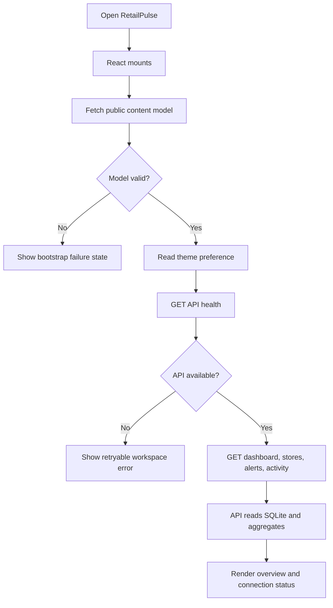

#### 2. Filter performance

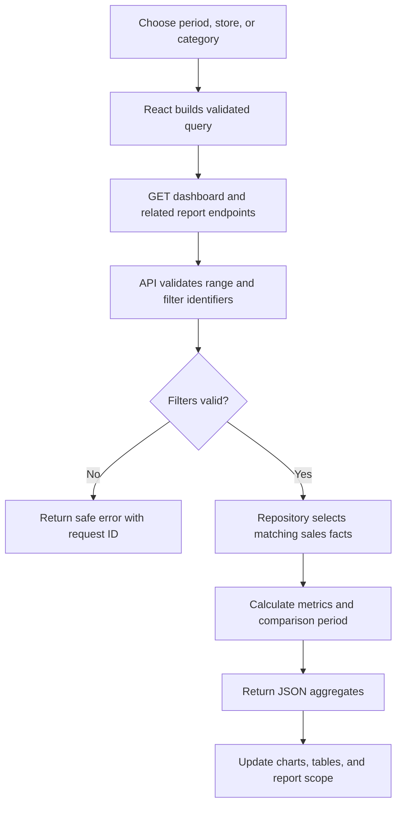

#### 3. Review revenue

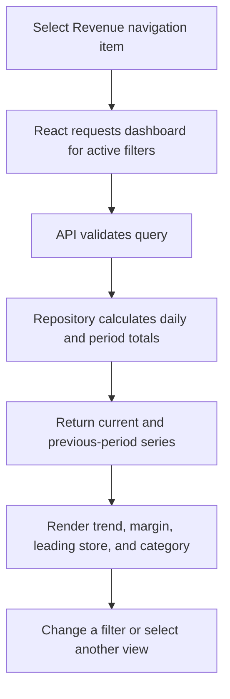

#### 4. Compare and inspect a store

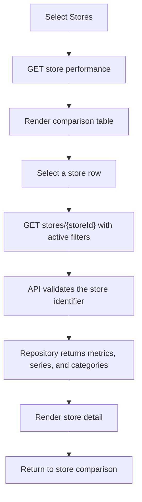

#### 5. Search and inspect a product

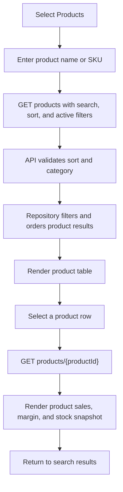

#### 6. Update an alert

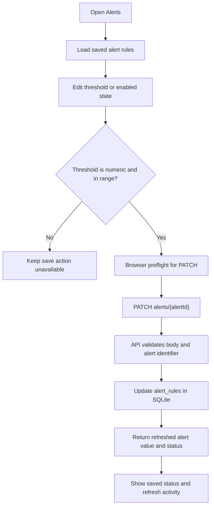

#### 7. Add sales records

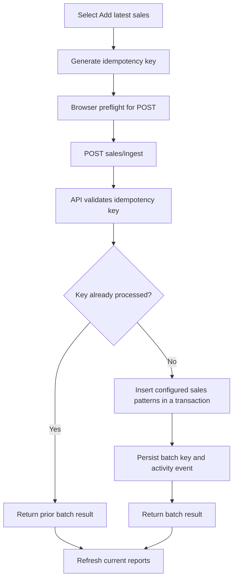

#### 8. Export a report

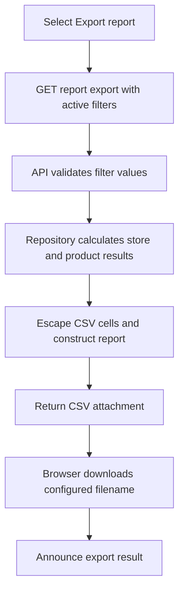

#### 9. Change appearance

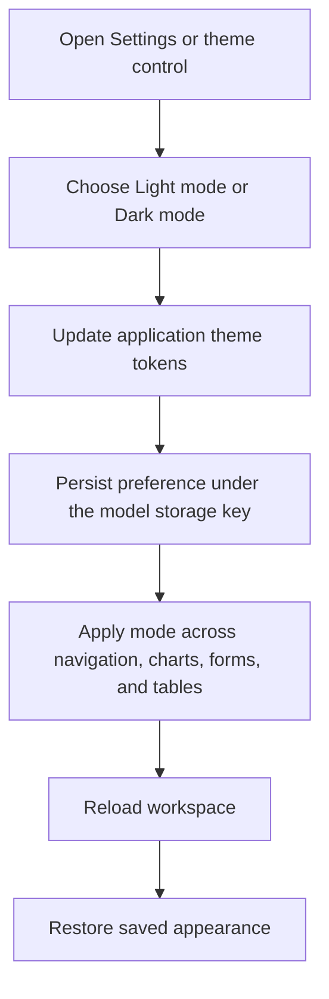

#### 10. Recover from an API error

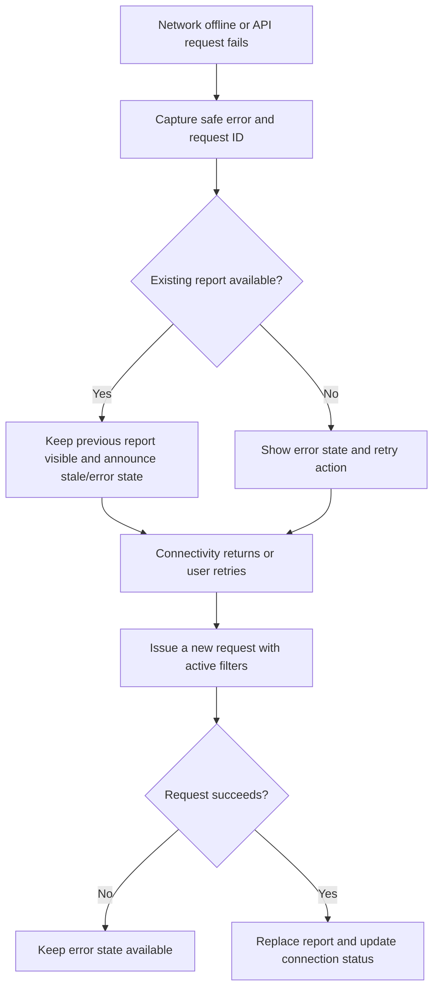

## 6. Domain, persistence, and data ownership

The frontend consumes server-owned domain records; its model supplies presentation and synthetic display content. Local UI state cannot replace backend transaction or authorization decisions.

### Data ownership

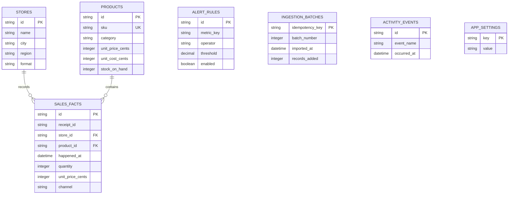

The API owns `stores`, `products`, `sales_facts`, `alert_rules`, `ingestion_batches`, `activity_events`, and `app_settings`. Sales amounts are stored as integer cents. Ingestion uses idempotency keys; alert changes and batch records are persisted transactionally. Seed records and labels come from `retailpulse-model.json`, whose strict envelope contains `version`, `appId`, `locale`, `messages`, and `data`. Backend unit tests use in-memory SQLite; the running service uses its configured local SQLite file.

## 7. API and internal contracts

The companion API contract is in [retailpulse-backend](https://github.com/gopichand-retail-apps/retailpulse-backend). It remains the authority for request/response shapes; the local typed/validated adapter is in the source map. There is no standalone OpenAPI file in this baseline; executable route definitions and validation schemas define the API.

### API contract

All business routes are under `/api/v1`; the API returns request IDs and stable error codes.

| Route                                                                  | Purpose                                           |
| ---------------------------------------------------------------------- | ------------------------------------------------- |
| `GET /health`, `GET /dashboard`, `GET /stores`, `GET /stores/:storeId` | Health and reporting aggregates                   |
| `GET /products`, `GET /products/:productId`                            | Product performance and details                   |
| `GET /alerts`, `PATCH /alerts/:alertId`                                | Read/update local thresholds                      |
| `GET /activity`, `GET /reports/export`                                 | Activity and filtered CSV export                  |
| `POST /sales/ingest`                                                   | Idempotent insertion of configured sales patterns |

There is no authentication or resource ownership layer today. The API binds to loopback addresses for local use; it must not be exposed externally until identity and server-side authorization are implemented.

## 8. Security, privacy, and egress

Current release limitation: **No authentication or authorization: keep the API loopback-only. Four formatting failures and desktop-to-320px Products overflow remain in the baseline; fresh mobile viewports pass.**

### Identity and authorization

| Actor/profile                         | Current identity                                                                       | Read scope                             | Write scope                                      | Enforcement                                                   |
| ------------------------------------- | -------------------------------------------------------------------------------------- | -------------------------------------- | ------------------------------------------------ | ------------------------------------------------------------- |
| Local browser viewer                  | The model displays a synthetic "Retail analyst" label; it is not an authenticated user | All locally seeded stores and products | Alert changes and configured synthetic ingestion | No authentication, role checks, or per-store ownership checks |
| Analyst, store manager, administrator | Not implemented                                                                        | Not implemented                        | Not implemented                                  | These are blueprint personas only, not active roles           |

CORS and loopback binding reduce accidental exposure but are not authorization.
Every local API client currently shares the same permissions and synthetic data.
Do not expose the service or connect retailer/customer records until identity,
server-side role and tenant ownership, and negative cross-user tests exist.

### Integration inventory

| System                                   | Status         | Data boundary                                                           |
| ---------------------------------------- | -------------- | ----------------------------------------------------------------------- |
| Point-of-sale provider                   | Absent         | Ingestion inserts configured synthetic sales patterns only              |
| Identity provider                        | Absent         | The browser's display name/role is content-model text, not a credential |
| Carrier, payments, or financial provider | Absent         | No external financial or fulfillment action is performed                |
| PortfolioOps collector                   | Not configured | API logs are written as structured JSON to local stdout                 |

Keep private credentials out of public models, browser bundles, logs, URLs, and source archives. No additional runtime network destination or external service is configured. Keep logs limited to the source-defined request/trace and safe aggregate fields. Backups, retention, deletion, and real-user ownership need explicit product/operations decisions before external exposure.

## 9. Design, accessibility, and platform adapters

The existing product styling is authored in [src/App.css](../src/App.css), [src/index.css](../src/index.css). Preserve its tokens, layout density, fonts/assets, breakpoints, and component states. User-facing strings/locale rules follow the active validated model. WCAG 2.2 AA is a target, not a verified conformance claim: keyboard/focus/dialog behavior, zoom/reflow, contrast, reduced motion, and screen readers require their applicable checks. No redesign or new visual measurements were performed here. Native/mobile packaging and device adapters are **not implemented by this web repository**.

## 10. Build, checks, and deployment

Configured npm scripts, from this repository with Node **24.15.0**; use `npm.cmd` in PowerShell:

| Command                    | Actual manifest definition                                                                                             |
| -------------------------- | ---------------------------------------------------------------------------------------------------------------------- |
| `npm.cmd run dev`          | `vite --host 127.0.0.1 --port 5701 --strictPort`                                                                       |
| `npm.cmd run build`        | `tsc -b && vite build`                                                                                                 |
| `npm.cmd run lint`         | `eslint . --max-warnings=0`                                                                                            |
| `npm.cmd run format:check` | `prettier --check 'src/**/*.{ts,tsx,css}' 'e2e/**/*.ts' 'public/**/*.json' '.github/workflows/*.yml' '*.{ts,js,json}'` |
| `npm.cmd run typecheck`    | `tsc --noEmit -p tsconfig.app.json`                                                                                    |
| `npm.cmd run preview`      | `vite preview --host 127.0.0.1 --port 5701 --strictPort`                                                               |
| `npm.cmd run test`         | `vitest run`                                                                                                           |
| `npm.cmd run test:cov`     | `vitest run --coverage`                                                                                                |
| `npm.cmd run test:e2e`     | `node scripts/test-e2e.mjs`                                                                                            |

Install with `npm.cmd ci` and retain [package-lock.json](../package-lock.json). Registry access is required for a clean dependency installation. These commands describe the configured checks; execution results are listed in section 13.

Frontend address: http://127.0.0.1:5701. API health: http://127.0.0.1:5702/api/v1/health. Vercel uses [vercel.json](../vercel.json) and the documented keys in [.env.vercel.example](../.env.vercel.example). The static output is dist; SPA fallback excludes API/socket paths. The environment example is not automatically loaded under that filename. Public endpoints and mode selectors are build inputs; rebuild/redeploy after changes. A hosted frontend still requires an independently verified API.

CI configuration is listed in section 3. Run the configured checks before merging or releasing. Deployment requires separate verification of the selected hosting environment.

## 11. Architecture decisions and tradeoffs

### Implemented design patterns and invariants

- **Modular monolith:** one loopback Node process owns the versioned API; there
  are no separately deployed domain services.
- **Repository boundary:** `analytics.repository.mjs` owns SQLite schema setup,
  parameterized queries, aggregate reads, and writes. HTTP route handlers call
  this repository directly; a separate application-service layer is not
  currently implemented.
- **Pure reporting calculations:** UTC date ranges, grouping, revenue/margin
  calculations, and alert comparisons live in `analytics.metrics.mjs`.
- **Atomic writes:** alert changes and their activity event share a SQLite
  transaction. Ingestion atomically writes generated sales rows, its
  idempotency record, and activity event. A failed batch rolls back and can be
  retried with the same key.
- **Server-side input validation:** report filters, alert bodies, idempotency
  keys, bounded JSON payloads, and the strict content-model envelope are
  validated before use. SQLite reads use bound parameters.
- **Safe output:** CSV text cells that can trigger spreadsheet formulas are
  prefixed before quoting; numeric report cells are not altered.
- **Abortable browser reads:** route/filter changes cancel stale API reads;
  product search is debounced before network requests. There is no shared
  client cache or read-request deduplication layer.
- **API response isolation:** UI error mapping uses stable API codes and
  model-backed copy; raw backend error messages are not rendered.

There is no event bus, transactional outbox, background worker, Redis cache, or
database migration framework. SQLite tables are initialized by repository
startup code. These patterns are not claimed as present.

The two Git repositories remain separate. Each owns one maintained README and this repository-local architecture guide. Shared application behavior may be described here for contract context, but implementation changes belong to the owning source module.

## 12. Requirements traceability

| Capability                      | Acceptance                                                        | Owner/path                         | Current status                                                | Evidence                               | Risk                                                                                                                                                                                 |
| ------------------------------- | ----------------------------------------------------------------- | ---------------------------------- | ------------------------------------------------------------- | -------------------------------------- | ------------------------------------------------------------------------------------------------------------------------------------------------------------------------------------ |
| Repository-local architecture   | Guide available in this checkout and linked from README           | docs/architecture.md; README.md    | Documented and validated                                      | File, link, and diagram checks         | Keep documentation consistent with source changes                                                                                                                                    |
| UI composition and API boundary | Preserve existing workflows and failure states                    | src/main.tsx and source map        | Implemented; application verification limits are listed below | Current source and existing app design | No authentication or authorization: keep the API loopback-only. Four formatting failures and desktop-to-320px Products overflow remain in the baseline; fresh mobile viewports pass. |
| Public deployment               | Verified identity, data durability, recovery, and hosted behavior | Existing deployment/API boundaries | Needs separate hardening/verification                         | No new hosted evidence                 | Local checks do not establish production readiness                                                                                                                                   |

## 13. Dated verification and limitations

Last documentation review: **2026-11-09**. The checks below distinguish documentation validation from application and deployment testing.

- Repository-local guide, README link, source-path references, section/contents anchors, and Mermaid syntax: passed documentation validation.
- New application tests/builds, coverage, dependency audits, browser/device accessibility/performance, hosted CI, and Vercel deployment: **not rerun for the documentation updates**.
- Frontend production builds passed on 2026-11-09 with Node 24.15.0. Build success does not establish that all application quality gates pass.
- Outstanding baseline limit: No authentication or authorization: keep the API loopback-only. Four formatting failures and desktop-to-320px Products overflow remain in the baseline; fresh mobile viewports pass.

The baseline results below record earlier validation. Re-run the listed commands against the current revision before release.

Previously recorded application verification:

### Verification and known gaps

The frontend is built as a separate repository from the Node API. API-mode
browser tests use an isolated in-memory SQLite service on ports 5703/5704; the
unselected mock/live endpoint is made unavailable by the E2E runner.

| Scope                      | Command                               | Verified result                                                                               |
| -------------------------- | ------------------------------------- | --------------------------------------------------------------------------------------------- |
| Backend syntax             | `npm run check`                       | Pass                                                                                          |
| Backend tests and coverage | `npm run test:cov`                    | 26 tests; 100% statements, lines, and functions; 97.4% branches                               |
| Backend dependency audit   | `npm audit`                           | 0 vulnerabilities                                                                             |
| Frontend lint/build        | `npm run lint && npm run build`       | Pass                                                                                          |
| Frontend unit coverage     | `npm run test:cov`                    | 26 tests; 98.67% statements, 90.23% branches, 98.89% functions, 99.30% lines                  |
| Mock API selection         | `VITE_IS_MOCK=true npm run test:e2e`  | 15/15 passed against the isolated local API                                                   |
| Live API selection         | `VITE_IS_MOCK=false npm run test:e2e` | 15/15 passed against the isolated local API; this verifies routing, not a production database |
| Frontend dependency audit  | `npm audit`                           | 0 vulnerabilities                                                                             |

The API has no OpenAPI document, identity/role/tenant authorization, migrations,
production database, or external POS integration. SAST/secret scanning,
Core Web Vitals, slow-device/network budgets, CDN caching/compression,
PostgreSQL backup/restore, and hosted IT/QA-to-production isolation have not
been verified or configured. Keep those as explicit release blockers for any
external deployment, not as claims of completed work.

## 14. Extension rules and companion repository

Start with [README.md](../README.md) and this guide. The companion repository is [retailpulse-backend](https://github.com/gopichand-retail-apps/retailpulse-backend); clone the pair as siblings when using the existing local integration/model contract. This guide is inside the current repository and does not depend on a parent-folder architecture file to exist.

Update this guide when owned source, routes, persistence, identity, UI states, egress, or deployment behavior changes. Coordinate public contract changes with the companion repository and tests. Preserve existing data, run isolated checks with synthetic records, record failures, and review release and infrastructure changes before publication.
